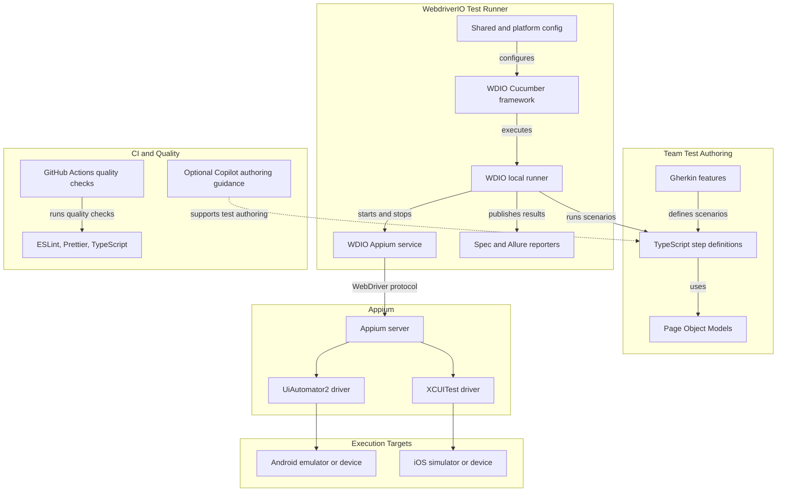
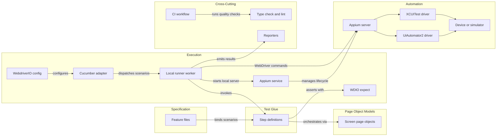

# Architecture Diagram

This is the architecture of a reusable mobile end-to-end testing template using WebdriverIO, Cucumber, TypeScript, and Appium. It includes separate local Android and iOS configurations, with app-specific tests organized around Page Object Models.

## Application Architecture

<!-- mermaid-checked: no \n, no em-dash/en-dash, no {} in labels, subgraphs are id["label"], arrows are -->|"label"|, all subgraphs closed by end, ids unique -->

### Technology Stack Summary

| Layer | Technology | Version | Purpose |
|---|---|---|---|
| Test authoring | Gherkin and Cucumber | Pinned in the template lockfile | Readable, scenario-oriented test specifications |
| Test implementation | TypeScript and Page Object Models | Pinned in the template lockfile | Typed step definitions and reusable screen interactions |
| Test runner | WebdriverIO Testrunner and local runner | 10.1.0 | Configuration, execution, and parallel workers |
| Mobile automation | Appium with UiAutomator2 and XCUITest drivers | Appium 3.8.0; drivers installed with Appium CLI | Native Android and iOS automation |
| Appium lifecycle | `@wdio/appium-service` | Pinned compatible version | Local Appium server lifecycle for local runs |
| Assertions | WDIO `expect` and `expect-webdriverio` | Pinned compatible versions | Browser and native-app assertions |
| Reporting | WDIO spec reporter and optional Allure reporter | Pinned compatible versions | Console feedback and persistent test reports |
| Static quality | ESLint, Prettier, and TypeScript compiler | Pinned in the template lockfile | Linting, consistent formatting, and type checking |
| Continuous integration | GitHub Actions | Hosted workflow | Repeatable checks and platform-specific test jobs |
| AI assistance | Copilot instructions and optional approved MCP integrations | Team-configured | Assist test authoring and diagnosis without affecting runtime execution |

### Data Storage & External Services

The template does not require an application database or test-result database. Test execution communicates with an Appium server and a local emulator, simulator, or connected device. Reports are generated as local build artifacts and may be retained by CI. Device identifiers and app paths belong in environment-specific configuration; credentials for any future cloud device provider belong in CI secrets, not in source control.

### Key Architectural Decisions

- Keep shared runner behavior in a common WebdriverIO configuration, with small Android and iOS overrides and environment-based app/device settings.
- Use official WebdriverIO, Cucumber, and Appium packages and CLI-managed Appium drivers. Step definitions orchestrate scenarios through Page Object Models, which own screen selectors and user-facing actions.
- Treat AI tools as optional authoring and debugging aids. Test execution, assertions, and CI remain deterministic and do not depend on an AI service.

## Component Relationships

<!-- mermaid-checked: no \n, no em-dash/en-dash, no {} in labels, subgraphs are id["label"], arrows are -->|"label"|, all subgraphs closed by end, ids unique -->

### Component Inventory

| Component | Layer | Type | Responsibility |
|---|---|---|---|
| Feature files | Specification | Gherkin specifications | Describe user-visible mobile scenarios |
| Step definitions | Test Glue | Cucumber bindings | Map scenario steps to screen actions and assertions |
| Screen page objects | Page Object Models | Page Object Model | Encapsulate screen selectors and user-facing actions |
| WebdriverIO config | Execution | Runner configuration | Define capabilities, services, framework, reporters, and platform settings |
| Cucumber adapter | Execution | WebdriverIO framework adapter | Connect feature files and step definitions to the runner |
| Local runner worker | Execution | WebdriverIO runner | Execute scenarios against a configured device target |
| Appium service | Execution | WebdriverIO service | Start and stop a local Appium server when using local execution |
| WDIO expect | Execution | Assertion library | Provide assertions for test outcomes |
| Appium server | Automation | WebDriver server | Route automation commands to the configured platform driver |
| UiAutomator2 driver | Automation | Appium platform driver | Automate Android applications |
| XCUITest driver | Automation | Appium platform driver | Automate iOS applications |
| Device or simulator | Automation | Execution target | Run the application under test |
| Reporters | Cross-Cutting | Test reporters | Present run output and produce optional report artifacts |
| CI workflow | Cross-Cutting | GitHub Actions workflow | Run static quality checks on changes |
| Type check and lint | Cross-Cutting | CI checks | Validate TypeScript, lint rules, and formatting |
